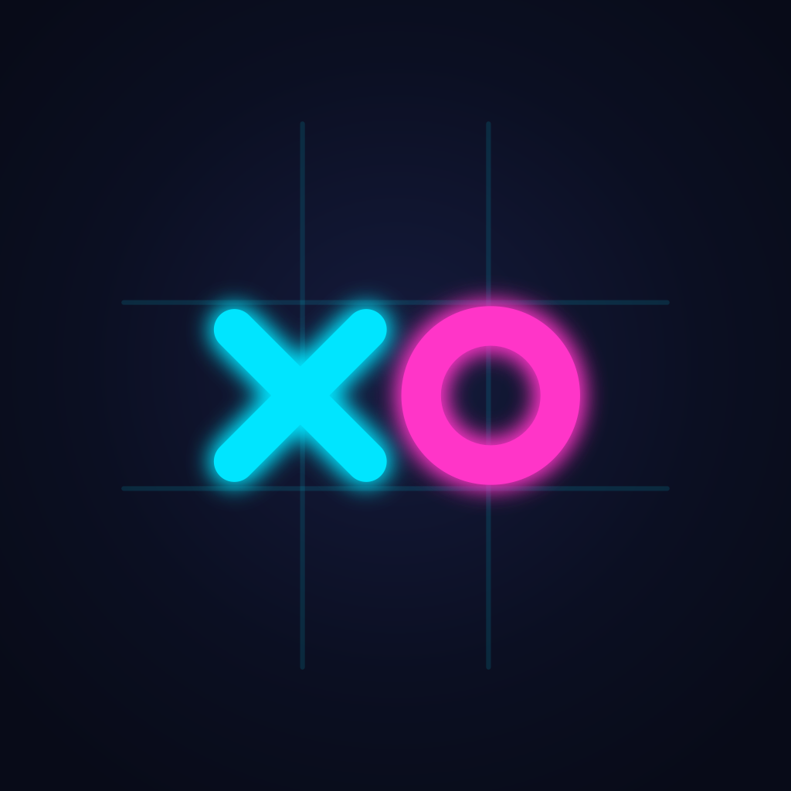
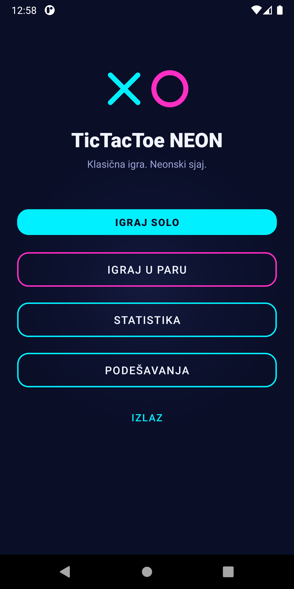
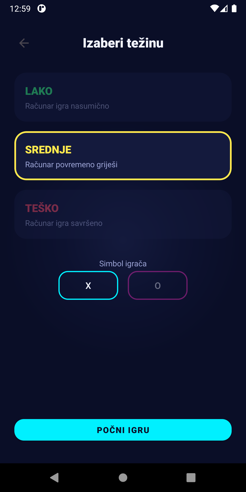
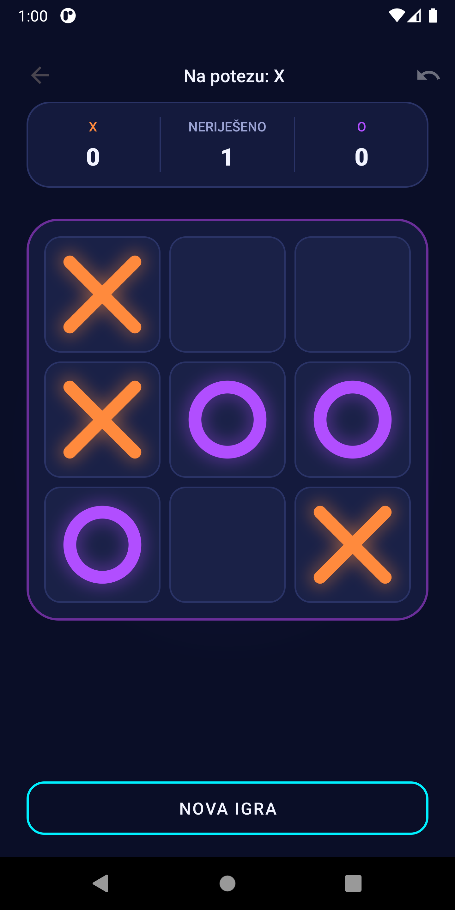
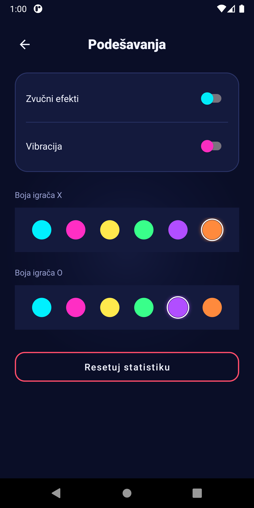
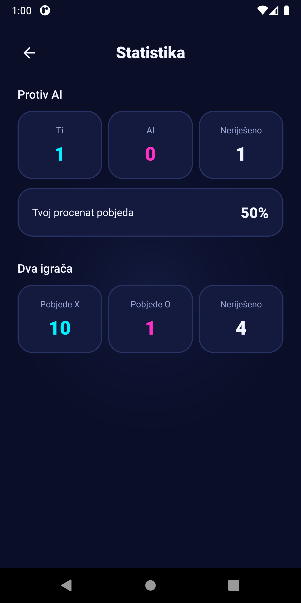

<p align="center">
  
</p>

<h1 align="center">TicTacToe NEON</h1>

<p align="center">
  Android iks-oks igra u neon stilu: igraj protiv računara na tri nivoa težine ili sa prijateljem na istom uređaju.
</p>

---

## Funkcionalnosti

- **SOLO mod** – igra protiv računara (AI) na tri nivoa težine:
  - **Lako** – računar igra nasumično,
  - **Srednje** – računar povremeno griješi,
  - **Teško** – računar igra savršeno i nikad ne gubi.
- **DUO mod** – dva igrača na istom uređaju.
- **Izbor simbola** – u SOLO modu biraš da li igraš kao X ili O.
- **Vraćanje poteza** (undo).
- **Skor meča** – pobjede X, pobjede O i neriješene partije u tekućem meču.
- **Podešavanja** – zvučni efekti, vibracija i boje igrača X i O.
- **Statistika** – odvojena za SOLO (ti / AI / neriješeno, procenat tvojih pobjeda) i DUO (pobjede X / O / neriješeno).
- **Adaptivna ikonica** sa monochrome slojem za *themed icons* (Android 13+).

## Screenshot-ovi

| Početni ekran | Izbor težine | Igra | Podešavanja | Statistika |
|:---:|:---:|:---:|:---:|:---:|
|  |  |  |  |  |

## Tehnologije

| Oblast | Tehnologija |
|---|---|
| Jezik | Java 11 |
| UI | XML Views + ViewBinding, Material Components, ConstraintLayout |
| Arhitektura | MVVM (`ViewModel` + `LiveData`) |
| Čuvanje podataka | `SharedPreferences` (podešavanja i statistika) |
| Testiranje | JUnit 4 (unit testovi na JVM-u) |
| Android | minSdk 24 (Android 7.0), targetSdk 36, edge-to-edge prikaz |

## Arhitektura

Aplikacija koristi **MVVM** (Model – View – ViewModel): ekran (Activity) samo prikazuje stanje i javlja
korisnikove akcije, a logika igre živi u ViewModel-u i modelu.

```
ui (Activity, custom View)  ──posmatra LiveData──▶  viewmodel  ──▶  model, ai
                                                        │
                                                        └──▶  repository (SharedPreferences)
```

| Paket | Odgovornost |
|---|---|
| `model` | Čista Java bez Android zavisnosti: tabla (`Board`), pravila pobjede, potezi, statistika (`GameStats`, `SoloStats`) |
| `ai` | `TicTacToeAI` – računa potez računara za izabranu težinu |
| `repository` | `PreferencesRepository` – čita i snima podešavanja i statistiku |
| `viewmodel` | `GameViewModel` (tok partije, skor, undo, AI potez), `SettingsViewModel` (podešavanja i statistika) |
| `ui` | Activity klase (`menu`, `game`) i custom View-ovi (`SymbolView`, `WinLineView`, `ColorSwatchView`) |
| `util` | Pomoćne klase: zvuk, vibracija, `Event` wrapper za jednokratne događaje, `InsetsHelper` za sistemske trake |

## Kako radi AI

Na nivou **Teško** računar koristi algoritam **minimax** sa **alfa-beta odsijecanjem**:
isproba sve buduće poteze obje strane (pod pretpostavkom da i protivnik igra savršeno) i bira potez
sa najboljim ishodom. Brža pobjeda se boduje više od kasnije.

- **Lako** – uvijek nasumično slobodno polje.
- **Srednje** – pola poteza najbolji potez, pola nasumičan.
- **Teško** – uvijek najbolji potez.

Da Teško zaista nikad ne gubi, provjerava unit test koji odigra **svaku moguću partiju** protiv računara,
i kada računar igra prvi i kada igra drugi.

## Pokretanje

1. Kloniraj repozitorijum:
   ```bash
   git clone https://github.com/NemanjaAdzic83/TicTacToe_XO.git
   ```
2. Otvori folder u **Android Studiju** i sačekaj da se završi Gradle sync.
3. Poveži Android uređaj (Android 7.0 ili noviji) ili pokreni emulator.
4. Klikni **Run ▶** (konfiguracija `app`).

Build iz terminala:
```bash
./gradlew :app:assembleDebug        # Windows: gradlew.bat :app:assembleDebug
```

## Testovi

Unit testovi se izvršavaju na računaru (JVM), bez uređaja:

```bash
./gradlew :app:testDebugUnitTest    # Windows: gradlew.bat :app:testDebugUnitTest
```

| Test klasa | Testova | Šta provjerava |
|---|:---:|---|
| `SoloStatsTest` | 8 | Prevod X/O ishoda u ti/AI statistiku, procenat pobjeda |
| `BoardTest` | 15 | Polja table, svih 8 pobjedničkih linija, neriješeno, kopija table |
| `TicTacToeAITest` | 15 | Pravila za sve težine, pobjeda/blokiranje na Teško, iscrpna provjera da Teško nikad ne gubi |

U Android Studiju: desni klik na `app/src/test/java` → **Run 'Tests in…'**.

## Autor

[NemanjaAdzic83](https://github.com/NemanjaAdzic83)
